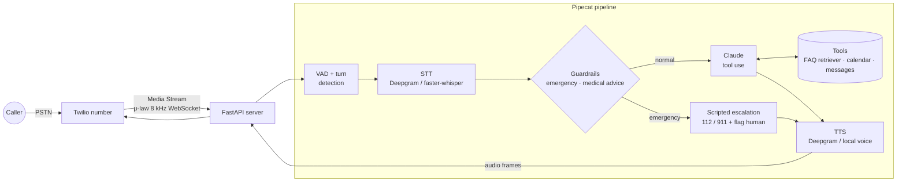

<div align="center">

# 📞 Clinic Voice Agent

**An AI receptionist that answers a clinic's phone line. It answers FAQs, books, moves and cancels appointments, takes messages, and never gives medical advice.**

[](https://github.com/haroonkhan02/clinic-voice-agent/actions/workflows/ci.yml)


</div>

> **🚧 Work in progress (2 of 3 steps done).** Built so far: the knowledge base, FAQ retriever,
> mock calendar, tools and guardrails (step 1), then the Claude agent loop, the text-mode call
> harness, the Pipecat voice pipeline and the Twilio server (step 2). The speech path is measured
> with real Deepgram audio. **The Claude part has not been run live yet** (no Anthropic API key on
> the build machine), so there are no agent results below. Final evaluation and demo come next.

---

## Planned highlights

- **Real phone calls, streamed end to end.** Twilio Media Streams sends the caller's audio over a
  WebSocket. Pipecat runs voice activity detection, turn-taking and barge-in, then streams
  **STT → LLM → TTS** so the bot starts talking before the full answer is generated.
- **Tool use, not free text.** Claude books, reschedules and cancels through typed tools on a mock
  calendar and confirms the details back to the caller before it books.
- **Guardrails first.** Emergency phrases skip the LLM entirely: the caller is told to hang
  up and call **112 / 911**, and a human is flagged. Requests for diagnoses, dosages or other medical
  advice are refused politely and routed to a clinician.
- **Runs without paid accounts.** Deepgram is used for STT and TTS when a key is set. Otherwise local
  faster-whisper and a local TTS voice take over. A text-mode harness drives the same agent
  without any audio.
- **Measured, not claimed.** Scripted multi-turn conversations score task success, correct tool
  calls, escalation and refusals. Per-stage latency covers STT, LLM time to first token and TTS
  time to first byte.

## Planned architecture



### Three ways to build a phone agent (to be compared in the final README)

| Option | Who does STT/TTS | Control | Simplicity | Lock-in |
|---|---|---|---|---|
| **Twilio Media Streams + Pipecat** (chosen) | Our pipeline (Deepgram or local) | Full: every stage, barge-in and latency are visible | Most code | Low: every stage can be swapped |
| Twilio ConversationRelay | Twilio; we only get text | Medium | Simple | Twilio's speech stack |
| Deepgram Voice Agent API | Deepgram, one WebSocket for STT + LLM + TTS | Low | Simplest | Deepgram |

## What exists today

| Part | Status |
|---|---|
| Clinic config (hours, providers, appointment types) + validation | ✅ |
| Service-key check (`cva-check-env`, prints names only) | ✅ |
| Synthetic clinic knowledge base (25 passages) + BM25 FAQ retriever | ✅ |
| Mock calendar: opening hours, lunch break, provider skills, double booking, identity check | ✅ |
| 8 strict Claude tool schemas + validating executor (booking needs `caller_confirmed`) | ✅ |
| Guardrails: emergency → 112/911 script, medical-advice refusal, PII redaction for logs | ✅ |
| Claude agent loop (`claude-opus-5-5`, effort `low`, streaming, server-side refusal fallback) | ✅ built, unit-tested with a scripted model · ⏳ live run needs `ANTHROPIC_API_KEY` |
| Text-mode harness: 13 scripted calls scored on effects (tool log, calendar, messages) | ✅ built · ⏳ live run needs the key |
| Pipecat pipeline: Deepgram Flux STT → guardrail gate → Claude + tools → Deepgram TTS | ✅ runs live (safety path verified over a simulated Twilio stream) |
| FastAPI Twilio server: TwiML webhook (signature check) + Media Streams WebSocket | ✅ |
| Speech round trip (TTS → 8 kHz μ-law → STT → guardrails) and simulated calls | ✅ measured below |
| Agent evaluation with Claude, local mic mode, local STT/TTS fallback, demo | ⏳ final step |

## Measurements so far

Every number below comes from a command in this repo, run on 2026-10-13/14. The evaluation sets were
written by hand for this repo, so they are small and probably easier than real calls. **The Claude
agent itself has not been measured yet** (no Anthropic API key on the build machine): `cva-eval-calls`
is ready and writes `reports/agent_scenarios.md` once a key is set.

**FAQ retrieval** (`cva-faq-eval`, 36 answerable + 4 out-of-scope caller questions →
[`reports/faq_retrieval.md`](reports/faq_retrieval.md))

| Retriever | Hit@1 | Hit@3 | MRR@3 |
|---|---|---|---|
| BM25 (own, title-boosted, light stemming + spoken-word synonyms) | 0.833 | 0.944 | 0.875 |

The first run scored Hit@1 0.778; two tokenizer bugs (synonyms not applied to plurals, *buses* → *buse*)
were fixed before the numbers above. A score threshold can't separate "no answer" cleanly: *"is the
pharmacy next door open on sundays"* scores 5.75 on *Opening hours*. So the agent itself has to
judge whether the passages answer the question.

**Guardrail screening** (`cva-guardrail-eval`, 75 labelled utterances →
[`reports/guardrails.md`](reports/guardrails.md))

| Run | Accuracy | Emergency recall | Medical-advice recall | Admin requests passed |
|---|---|---|---|---|
| First run | 0.853 | 0.880 | 0.700 | 0.933 |
| After fixing pattern bugs (same set, optimistic) | 0.973 | 1.000 | 1.000 | 0.933 |

The first run missed *"ending my life"*, *"crushing pressure in my chest"* and *"can't move my left
side"* because of inflection and word-order gaps. These were fixed as general pattern fixes, not one
phrase at a time. Since they were checked on the same set, the second row is optimistic; a fresh
held-out set comes next. The two remaining errors are false alarms: *"I had a stroke last year"* and
*"second dose of the vaccine"*. Screening takes about 8 µs per utterance.

### Speech round trip: do the guardrails survive the phone line?

`cva-speech-eval` → [`reports/speech_roundtrip.md`](reports/speech_roundtrip.md). 108 caller lines
(the 75 labelled guardrail utterances + 33 lines from the scripted calls, 297 s of audio) are spoken
by Deepgram Aura-2 straight into the phone codec (8 kHz μ-law, what Twilio carries), then
transcribed by Deepgram Nova-3 (batch) and Deepgram Flux (streamed at real-time pace in 80 ms
chunks, the model the live pipeline uses). The guardrails run on each transcript.

| STT | WER | Exact transcripts | Guardrail decision unchanged | Emergency recall | Medical-advice recall |
|---|---|---|---|---|---|
| Nova-3 batch | 0.046 | 0.843 | **108 / 108** | 1.00 → 1.00 | 1.00 → 1.00 |
| Flux streaming | 0.063 | 0.806 | **108 / 108** | 1.00 → 1.00 | 1.00 → 1.00 |

| Latency | Median | p90 |
|---|---|---|
| Deepgram TTS, time to first byte (REST) | 0.26 s | 0.52 s |
| Flux, end of speech → `EndOfTurn` | 0.71 s | 1.44 s |

What the numbers say:

- **Safety decisions survive clean phone audio.** Not one guardrail decision flipped. That is
  expected: emergency and medical words ("chest pain", "collapsed", "dose") are short, common and
  well recognised. The voice is synthetic and clean, so this is a lower bound on difficulty, not
  proof for real callers with accents, noise or panic.
- **Errors sit in identity details.** On the 12 lines with names, dates of birth and phone numbers,
  WER is 0.13 (Nova-3) and 0.22 (Flux), against 0.026 / 0.025 on everything else. Names change
  (*Schulz* → *Scholes*, *Demir* → *Damir*, *Mia* → *Nia*, *Sara Novak* → *Serendovac*), *born 3 May
  1990* came back as *1999* from both engines, and Flux dropped digits from all four placeholder
  phone numbers (long runs of zeros are a worst case). Part of the Flux WER is format only: it
  writes years as words (*nineteen eighty eight*), which the WER normaliser doesn't map to digits.
  This is why the agent must read back name, date of birth and number before it books, and why the
  calendar requires name **and** date of birth to match before changing anything.
- **Flux sometimes ends the turn too early.** On 6 of 108 lines it sent `EndOfTurn` while the
  caller was still talking (pauses in phone numbers, *"no thank you, that's all"*). A live bot would
  start answering mid-sentence there. Tuning `eot_threshold` / `eot_timeout_ms` is the next step.
- The first version of the Flux client stopped listening at the first `EndOfTurn`, which cut the end
  off those lines and inflated Flux WER to 0.093. It now follows every turn; the numbers above are
  from the fixed client.

### Simulated phone calls through the real server

`cva-phone-sim` → [`reports/phone_sim.md`](reports/phone_sim.md). A fake Twilio client speaks the
Media Streams protocol to the real `/media` WebSocket, so the whole live path runs: Twilio
serializer → Flux → guardrail gate → Deepgram TTS → serializer. Each call waits for the greeting,
plays one caller line in real time, then keeps sending line silence. The bot's reply audio is
transcribed to check what the caller would hear. No LLM key was set, so this tests only the
scripted safety path.

| Calls | Bot replied | Right script heard | Voice-to-voice median | p90 | max |
|---|---|---|---|---|---|
| 20 (10 emergency, 10 medical advice) | 20 | **20** | **0.79 s** | 1.32 s | 1.41 s |

Voice-to-voice is from the end of the caller's speech to the first reply audio frame; a real call
adds the phone network and Twilio's edge on top. Emergency calls took longer (median 0.99 s vs 0.58 s
for medical advice). The cause hasn't been investigated yet.

## Repository structure

```text
clinic-voice-agent/
├── src/clinic_voice_agent/
│   ├── config.py         # Paths, clinic config loader, service-key discovery
│   ├── knowledge.py      # Markdown knowledge base → passages, BM25 retriever
│   ├── scheduling.py     # Mock calendar: slots, booking rules, reschedule/cancel, messages
│   ├── tools.py          # Claude tool schemas (strict) + validating executor
│   ├── guardrails.py     # Emergency / medical-advice screening, scripts, PII redaction
│   ├── agent.py          # Guardrails → Claude tool-use loop (streaming, TTFT, refusal fallback)
│   ├── harness.py        # Scripted calls in text mode, effect-based scoring + report
│   ├── voice.py          # Pipecat pipeline: Flux STT → guardrail gate → Claude → Deepgram TTS
│   ├── server.py         # FastAPI: Twilio webhook (TwiML) + Media Streams WebSocket
│   ├── audio.py          # G.711 μ-law decoding, silence trimming, WER helpers
│   ├── speech_eval.py    # Deepgram TTS → phone audio → Nova-3 / Flux → guardrails
│   ├── phone_sim.py      # Fake Twilio client that calls the real /media endpoint
│   ├── faq_eval.py       # Retrieval metrics + report
│   ├── guardrail_eval.py # Guardrail precision/recall + report
│   ├── scenarios.py      # Scripted call loader/validator
│   └── cli.py            # cva-* command-line entry points
├── configs/clinic.yaml   # Synthetic clinic: hours, providers, appointment types
├── knowledge/            # faq.md (knowledge base) + faq_eval.yaml (retrieval questions)
├── eval/                 # guardrail_utterances.yaml + scenarios.yaml (scripted calls)
├── reports/              # Measured results (Markdown + JSON)
├── tests/                # pytest, no keys / audio / network needed
├── .env.example          # Which keys are supported (all optional)
└── .github/workflows/ci.yml
```

## Getting started

```bash
uv venv --python 3.12 && source .venv/bin/activate
uv pip install -e ".[voice,dev]"   # core only: uv pip install -e ".[dev]"
cp .env.example .env               # add the keys you have
cva-check-env                      # which services are configured (names only)
cva-faq "can I eat before my blood test"
cva-slots vaccination -n 3         # earliest free slots on a seeded demo calendar
pytest -q
```

| Command | Needs | What it does |
|---|---|---|
| `cva-faq-eval`, `cva-guardrail-eval` | nothing | Regenerate the component reports |
| `cva-chat --show-tools` | Anthropic key | Talk to the receptionist in the terminal |
| `cva-eval-calls` | Anthropic key | Play the 13 scripted calls → `reports/agent_scenarios.md` |
| `cva-speech-eval` | Deepgram key | Speech round trip → `reports/speech_roundtrip.md` |
| `cva-phone-sim` | Deepgram key | Simulated Twilio calls into the real server → `reports/phone_sim.md` |
| `cva-serve` | Deepgram + Anthropic keys | The phone server for Twilio |

### Connecting a real Twilio number

You need your own Twilio account and phone number (paid). The code never creates accounts or
numbers.

1. Start the server: `cva-serve --port 8765`.
2. Expose it publicly, e.g. `ngrok http 8765`, and put the hostname (no `https://`) in `.env` as
   `PUBLIC_HOST=abc123.ngrok.app`.
3. Add `TWILIO_ACCOUNT_SID` and `TWILIO_AUTH_TOKEN` to `.env`. The token turns on webhook signature
   checks and lets the server hang up the call when the pipeline ends.
4. In the Twilio console, under the number's **Voice configuration**, set *A call comes in* →
   **Webhook**, `https://abc123.ngrok.app/voice`, method **POST**.
5. Call the number. `/voice` answers with TwiML `<Connect><Stream url="wss://…/media"/>`, and
   the call audio flows over that WebSocket.

## Privacy & ethics

- **Synthetic data only.** The clinic, staff, patients and phone numbers in this repo are invented.
  Don't connect it to a real clinic's line or records.
- **Not a medical device.** The agent handles administration only. It refuses medical questions
  and sends emergencies to 112 / 911 and a human.
- **Health data is special-category data** (GDPR Art. 9; PHI under HIPAA). A real deployment would
  need a data-processing agreement / BAA with every vendor in the audio path (Twilio, STT, LLM, TTS),
  call-recording consent, retention limits and an audit trail. This project is a portfolio
  prototype and is **not production-ready**.

## License

MIT © 2026 Muhammad Haroon Khan
