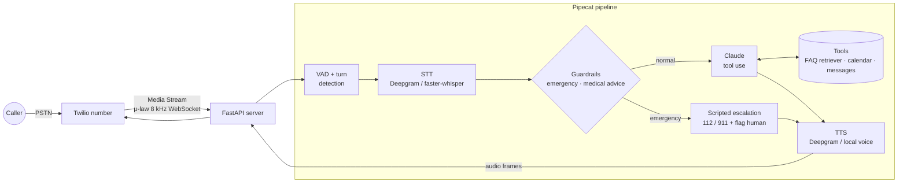

<div align="center">

# 📞 Clinic Voice Agent

**An AI receptionist that answers a clinic's phone line. It answers FAQs, books, moves and cancels appointments, takes messages, and never gives medical advice.**

[](https://github.com/haroonkhan02/clinic-voice-agent/actions/workflows/ci.yml)


</div>

> **🚧 Work in progress.** This is the foundation: config, the synthetic clinic knowledge
> base, the FAQ retriever, the mock appointment calendar, the tool layer, guardrails, tests and CI.
> The real-time voice pipeline (Pipecat + Twilio), the Claude agent and the evaluation
> results come in the next steps. The plan below describes the intended design. Numbers will appear
> here only after they have been measured.

---

## Planned highlights

- **Real phone calls, streamed end to end.** Twilio Media Streams sends the caller's audio over a
  WebSocket. Pipecat runs voice activity detection, turn-taking and barge-in, then streams
  **STT → LLM → TTS** so the bot starts talking before the full answer is generated.
- **Tool use, not free text.** Claude books, reschedules and cancels through typed tools on a mock
  calendar and confirms the details back to the caller before it books.
- **Guardrails first.** Emergency phrases skip the LLM entirely: the caller is told to hang
  up and call **112 / 911**, and a human is flagged. Requests for diagnoses, dosages or other medical
  advice are refused politely and routed to a clinician.
- **Runs without paid accounts.** Deepgram is used for STT and TTS when a key is set. Otherwise local
  faster-whisper and a local TTS voice take over. A text-mode harness drives the same agent
  without any audio.
- **Measured, not claimed.** Scripted multi-turn conversations score task success, correct tool
  calls, escalation and refusals. Per-stage latency covers STT, LLM time to first token and TTS
  time to first byte.

## Planned architecture



### Three ways to build a phone agent (to be compared in the final README)

| Option | Who does STT/TTS | Control | Simplicity | Lock-in |
|---|---|---|---|---|
| **Twilio Media Streams + Pipecat** (chosen) | Our pipeline (Deepgram or local) | Full: every stage, barge-in and latency are visible | Most code | Low: every stage can be swapped |
| Twilio ConversationRelay | Twilio; we only get text | Medium | Simple | Twilio's speech stack |
| Deepgram Voice Agent API | Deepgram, one WebSocket for STT + LLM + TTS | Low | Simplest | Deepgram |

## What exists today

| Part | Status |
|---|---|
| Clinic config (hours, providers, appointment types) + validation | ✅ |
| Service-key check (`cva-check-env`, prints names only) | ✅ |
| Synthetic clinic knowledge base (25 passages) + BM25 FAQ retriever | ✅ |
| Mock calendar: opening hours, lunch break, provider skills, double booking, identity check | ✅ |
| 8 strict Claude tool schemas + validating executor (booking needs `caller_confirmed`) | ✅ |
| Guardrails: emergency → 112/911 script, medical-advice refusal, PII redaction for logs | ✅ |
| 13 scripted evaluation calls (`eval/scenarios.yaml`) | ✅ written, scored next session |
| Claude agent, Pipecat pipeline, Twilio server | ⏳ next session |
| Agent evaluation, latency report, demo | ⏳ final session |

## Early measurements (components only)

These numbers cover the building blocks, not the voice agent. Both evaluation sets were written by
hand for this repo, so they are small and probably easier than real calls.

**FAQ retrieval** (`cva-faq-eval`, 36 answerable + 4 out-of-scope caller questions →
[`reports/faq_retrieval.md`](reports/faq_retrieval.md))

| Retriever | Hit@1 | Hit@3 | MRR@3 |
|---|---|---|---|
| BM25 (own, title-boosted, light stemming + spoken-word synonyms) | 0.833 | 0.944 | 0.875 |

The first run scored Hit@1 0.778; two tokenizer bugs (synonyms not applied to plurals, *buses* → *buse*)
were fixed before the numbers above. A score threshold can't separate "no answer" cleanly: *"is the
pharmacy next door open on sundays"* scores 5.75 on *Opening hours*. So the agent itself has to
judge whether the passages answer the question.

**Guardrail screening** (`cva-guardrail-eval`, 75 labelled utterances →
[`reports/guardrails.md`](reports/guardrails.md))

| Run | Accuracy | Emergency recall | Medical-advice recall | Admin requests passed |
|---|---|---|---|---|
| First run | 0.853 | 0.880 | 0.700 | 0.933 |
| After fixing pattern bugs (same set, optimistic) | 0.973 | 1.000 | 1.000 | 0.933 |

The first run missed *"ending my life"*, *"crushing pressure in my chest"* and *"can't move my left
side"* because of inflection and word-order gaps. These were fixed as general pattern fixes, not one
phrase at a time. Since they were checked on the same set, the second row is optimistic; a fresh
held-out set comes next. The two remaining errors are false alarms: *"I had a stroke last year"* and
*"second dose of the vaccine"*. Screening takes about 8 µs per utterance.

## Repository structure

```text
clinic-voice-agent/
├── src/clinic_voice_agent/
│   ├── config.py         # Paths, clinic config loader, service-key discovery
│   ├── knowledge.py      # Markdown knowledge base → passages, BM25 retriever
│   ├── scheduling.py     # Mock calendar: slots, booking rules, reschedule/cancel, messages
│   ├── tools.py          # Claude tool schemas (strict) + validating executor
│   ├── guardrails.py     # Emergency / medical-advice screening, scripts, PII redaction
│   ├── faq_eval.py       # Retrieval metrics + report
│   ├── guardrail_eval.py # Guardrail precision/recall + report
│   ├── scenarios.py      # Scripted call loader/validator
│   └── cli.py            # cva-check-env, cva-faq, cva-faq-eval, cva-guardrail-eval, cva-slots
├── configs/clinic.yaml   # Synthetic clinic: hours, providers, appointment types
├── knowledge/            # faq.md (knowledge base) + faq_eval.yaml (retrieval questions)
├── eval/                 # guardrail_utterances.yaml + scenarios.yaml (scripted calls)
├── reports/              # Measured results (Markdown + JSON)
├── tests/                # pytest, no keys / audio / network needed
├── .env.example          # Which keys are supported (all optional)
└── .github/workflows/ci.yml
```

## Getting started

```bash
uv venv --python 3.12 && source .venv/bin/activate
uv pip install -e ".[dev]"
cp .env.example .env               # optional: add the keys you have
cva-check-env                      # which services are configured (names only)
cva-faq "can I eat before my blood test"
cva-slots vaccination -n 3         # earliest free slots on a seeded demo calendar
cva-faq-eval && cva-guardrail-eval # regenerate reports/
pytest -q
```

## Privacy & ethics

- **Synthetic data only.** The clinic, staff, patients and phone numbers in this repo are invented.
  Don't connect it to a real clinic's line or records.
- **Not a medical device.** The agent handles administration only. It refuses medical questions
  and sends emergencies to 112 / 911 and a human.
- **Health data is special-category data** (GDPR Art. 9; PHI under HIPAA). A real deployment would
  need a data-processing agreement / BAA with every vendor in the audio path (Twilio, STT, LLM, TTS),
  call-recording consent, retention limits and an audit trail. This project is a portfolio
  prototype and is **not production-ready**.

## License

MIT © 2026 Muhammad Haroon Khan
