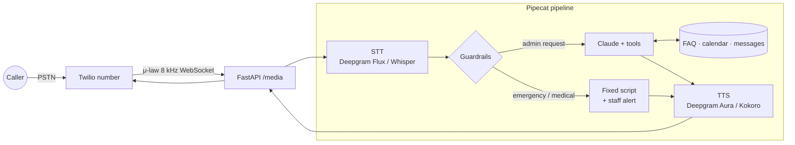
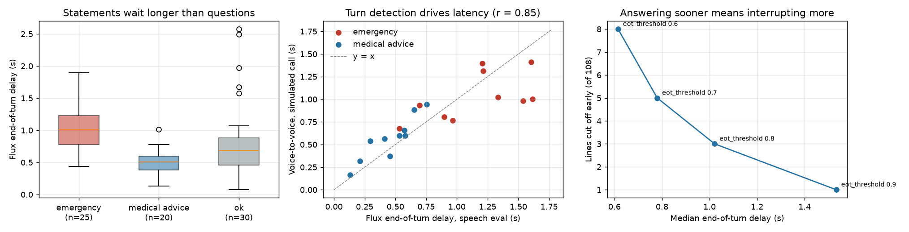

<div align="center">

# Clinic Voice Agent

An AI receptionist for a clinic's phone line. It answers FAQs, books, moves and cancels
appointments, takes messages, and never gives medical advice.

[](https://github.com/haroonkhan02/clinic-voice-agent/actions/workflows/ci.yml)


</div>

## What it does

- Takes calls from a Twilio number. Twilio Media Streams sends the caller's audio over a
  WebSocket and Pipecat runs speech-to-text, the agent and text-to-speech in a streaming loop
  with turn detection and barge-in.
- Uses Claude with typed tools for everything that touches the clinic: FAQ search, free slots,
  booking (only after the caller confirms the read-back), rescheduling, cancelling, messages.
- Screens every caller turn before the LLM. Emergencies get a fixed "hang up and call 112 / 911"
  script and a staff alert; requests for diagnoses or doses are politely refused.
- Runs without paid accounts: Deepgram (Flux STT, Aura TTS) when a key is set, otherwise Whisper
  and Kokoro on the CPU. A text mode and a fake-Twilio simulator test the whole path.

The conversation agent requires an Anthropic API key and has not been evaluated live yet; the
results below cover retrieval, guardrails, speech and the server's safety path.



## Results

All evaluation sets are small and written by hand for a synthetic clinic; the voice is
synthetic too. Details are in [`reports/`](reports).

**Safety and retrieval** (text, no audio)

| Check | Set | Result |
|---|---|---|
| Emergency recall (rules) | 25 dev lines, used to fix the patterns | 1.00 |
| Emergency recall (rules) | 20 held-out lines, written after freezing | **0.45** |
| Medical-advice recall (rules) | 20 dev / 15 held-out | 1.00 / 0.47 |
| False alarms on admin requests | 20 held-out | 0 |
| FAQ retrieval, own BM25 | 36 caller questions | Hit@1 0.83, Hit@3 0.94 |

**Speech over 8 kHz μ-law** (108 caller lines, 297 s)

| Speech path | WER | Guardrail decision unchanged |
|---|---|---|
| Deepgram Nova-3, batch | 0.046 | 108 / 108 |
| Deepgram Flux, streamed in real time | 0.063 | 108 / 108 |
| Whisper `base.en`, CPU int8 (0.24 s per clip) | 0.057 | 107 / 108 |
| Kokoro TTS → Whisper `base.en`, fully offline | 0.031 | 108 / 108 |

**Simulated phone calls** through the real server (10 emergency + 10 medical-advice callers)

| Speech in the server | Right script heard | Voice-to-voice median | p90 |
|---|---|---|---|
| Deepgram Flux + Aura | 20 / 20 | 0.79 s | 1.32 s |
| Whisper + Kokoro on the CPU | 19 / 20 | 2.24 s | 2.44 s |



The guardrail rules are the weak point. They look perfect on the lines they were tuned on and
miss more than half of new emergencies (*"my baby is turning blue"*, *"I can't catch my
breath"*), so keyword rules alone are not enough; Claude's system prompt is a second layer
but is untested without a key. Speech is not the bottleneck for safety: no Deepgram transcript
changed a guardrail decision, and errors cluster in names, birth dates and phone numbers,
which is why the agent reads them back. Latency is mostly turn detection: emergency
statements wait about twice as long for Flux's end-of-turn as questions do (median 1.01 s vs
0.51 s), and raising `eot_threshold` trades fewer interruptions for slower replies (right
panel). Offline, Kokoro's first audio takes about 2 s on the CPU, and one call failed because
the VAD split *"what are the side effects … of the flu vaccine"* into two fragments.

## Getting started

```bash
uv venv --python 3.12 && source .venv/bin/activate
uv pip install -e ".[voice,local,plots,dev]"   # tests only need: uv pip install -e ".[dev]"
cp .env.example .env                            # add the keys you have
cva-check-env                                   # which services are configured (names only)
cva-faq "can I eat before my blood test"
pytest -q
```

| Command | Needs | What it does |
|---|---|---|
| `cva-guardrail-eval --set heldout`, `cva-faq-eval` | nothing | Guardrail and retrieval reports |
| `cva-local-speech-eval` | nothing (downloads Whisper + Kokoro) | Offline speech round trip |
| `cva-speech-eval`, `cva-flux-sweep` | Deepgram key | Speech round trip, end-of-turn sweep |
| `cva-phone-sim [--speech local]` | Deepgram key (to check replies) | Fake-Twilio calls into the real server |
| `cva-chat`, `cva-eval-calls` | Anthropic key | Text conversation, 13 scripted calls scored on effects |
| `cva-mic` | PortAudio + `pyaudio` | Talk to it through the microphone |
| `cva-serve` | Anthropic key | The Twilio server |

### Connecting a Twilio number

You need your own Twilio account and number. Run `cva-serve --port 8765`, expose it with a
tunnel (`ngrok http 8765`), set `PUBLIC_HOST`, `TWILIO_ACCOUNT_SID` and `TWILIO_AUTH_TOKEN` in
`.env`, then point the number's voice webhook to `https://<host>/voice` (POST). The server
answers with TwiML that opens a media stream to `/media` and checks Twilio's signature.

## Repository structure

```text
clinic-voice-agent/
├── src/clinic_voice_agent/
│   ├── knowledge.py, scheduling.py, tools.py   # FAQ retriever, mock calendar, Claude tools
│   ├── guardrails.py, agent.py, harness.py     # safety screen, tool-use loop, scripted calls
│   ├── voice.py, server.py                     # Pipecat pipeline, FastAPI Twilio endpoints
│   ├── audio.py                                # G.711 μ-law codec, WER
│   ├── speech_eval.py, eot_sweep.py            # Deepgram round trip, Flux threshold sweep
│   ├── local_speech.py                         # Whisper + Kokoro offline round trip
│   ├── phone_sim.py                            # fake Twilio client for the real /media
│   ├── faq_eval.py, guardrail_eval.py, plots.py
│   └── cli.py                                  # cva-* entry points
├── configs/clinic.yaml      # synthetic clinic: hours, providers, appointment types
├── knowledge/               # FAQ knowledge base + retrieval questions
├── eval/                    # guardrail dev + held-out sets, scripted calls
├── reports/                 # measured results (Markdown + JSON) and figures
└── tests/                   # pytest, no keys, audio or network
```

## Design decisions

- **Pipecat on Twilio Media Streams** rather than Twilio ConversationRelay (Twilio does the
  speech and sends text) or Deepgram's Voice Agent API (one socket for STT, LLM and TTS). It is
  more code, but every stage is visible, swappable and measurable, and the guardrail gate can
  sit between STT and the LLM.
- **Guardrails before the LLM**, so the emergency path never depends on a model or its key.
- **Strict tool schemas plus a validating executor.** Booking needs `caller_confirmed: true`;
  changing or cancelling needs name and date of birth to match.
- **Scripted calls are scored on effects** (tool log, calendar, messages), not on wording.
- **Flux `eot_threshold` stays at 0.7**: 0.8 lowers the early cut-offs from 5 to 3 of 108 lines
  but adds about 0.25 s to the median reply.

## Limitations and future work

- The Claude agent and the 13 scripted calls have not been run (requires an Anthropic key).
- Guardrail recall on new phrasings is poor. Next: a learned classifier (sentence embeddings)
  OR-ed with the rules, scored on a fresh held-out set written by someone else.
- Emergency callers wait longest for end-of-turn; screening interim transcripts would let the
  bot react before the turn ends.
- Synthetic, clean voices only; real callers bring accents, noise and panic.
- Microphone mode needs `pyaudio`, which did not build against the macOS 27 SDK here, so it is
  untested.

## Privacy & ethics

All clinic, staff and patient data is invented. The agent handles administration only and is
not a medical device. Voice and health data are special-category data (GDPR Art. 9, PHI under
HIPAA): a real deployment would need data-processing agreements / BAAs with every vendor in the
audio path, recording consent, retention limits, audit logs and a human fallback. Logs are
redacted for phone numbers, e-mails and dates. This is a portfolio prototype, not
production-ready.

## License

MIT © 2026 Muhammad Haroon Khan
